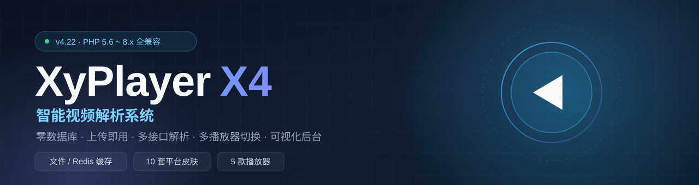
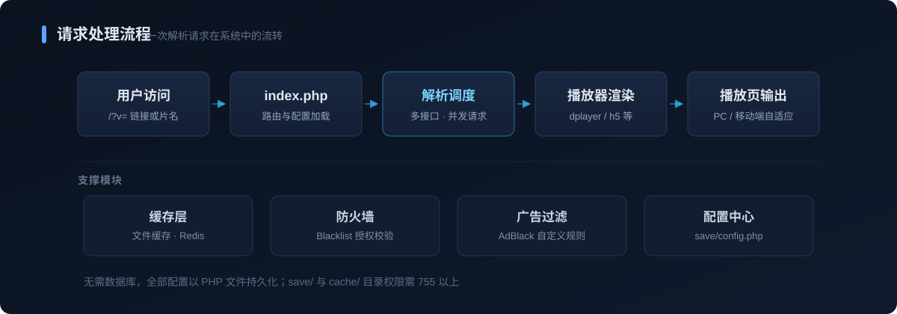

<div align="center">
  
  <br><br>

  
  
  
  
  
  

  <p>
    <b>零数据库 · 上传即用 · 多接口解析 · 多播放器切换 · 可视化后台</b><br>
    <sub>一套轻量的 PHP 视频解析系统，同时支持「解析接口」与「独立影视站」两种形态</sub>
  </p>

  [快速开始](#-快速开始) ·
  [调用方式](#-调用方式) ·
  [功能模块](#-功能模块) ·
  [目录结构](#-目录结构) ·
  [常见问题](#-常见问题) ·
  [开源协议](#-开源协议)
</div>

---

## 📖 项目简介

**XyPlayer X4** 是一款基于 PHP 的视频智能解析系统。它不需要安装数据库，把文件丢进网站根目录即可运行；前台输入一条视频链接或片名，系统自动调度第三方解析接口，返回可播放的地址，并交给内置播放器渲染。

除了解析能力，它还自带一个完整的影视站模块（`mov/`）：对接多家正版平台的公开接口，支持电视剧 / 电影 / 综艺 / 动漫分类、剧集连播与弹幕。

> 本版本（X4 / 4.22）对全量代码做了 **PHP 5.6 兼容性改造**，从老旧虚拟主机到 PHP 8.x 均可运行；同时完成了 **安全加固** 与 **搜索首页科技感重制**。

---

## ✨ 核心特性

| 特性 | 说明 |
| :--- | :--- |
| 🧩 **零数据库** | 全部配置以 PHP 文件持久化于 `save/`，无需 MySQL，迁移只需打包目录 |
| ⚡ **缓存加速** | 支持文件缓存与 Redis 缓存，命中后视频近乎秒开 |
| 🎬 **多播放器** | 内置 `dplayer`、`ckplayer`、`aliplayer`、`dmplayer`、`h5` 五套播放器，后台一键切换 |
| 🌌 **科技感首页** | `so.php` 内置粒子星座 + 透视网格 + 呼吸光晕背景，纯 CSS/Canvas 实现，零外部依赖 |
| 🎨 **多套模板** | 前台提供 `byg`（桌面）/ `default`（移动）两套模板；影视站内置 360 影视风格皮肤 |
| 🔌 **多接口解析** | 支持自定义第三方解析接口、接口测速与失败自动切换 |
| ☁️ **云播放** | 按链接或片名搜索资源站资源，无广告、可自定义资源站、支持剧集连播 |
| 🛡️ **防火墙** | 按域名 / 授权码放行，可用于给网站、APP 做接口授权 |
| 🚫 **广告过滤** | 自定义 AdBlack 规则，直接过滤视频内的插播广告 |
| 🔗 **链接跳转** | 命中指定视频链接时自动跳转到自定义地址（微信 / QQ 防红） |
| 💬 **弹幕系统** | `dmku/` 内置弹幕接口，支持 B 站弹幕池接入 |
| 🔗 **多端调用** | 提供 JSON / JSONP 接口与极简播放页，方便被公众号、小程序或 APP 二次对接 |
| 🖥️ **可视化后台** | 全部配置均在 `/admin` 中完成，无需手改代码，账号密码也可在后台修改 |

---

## 🎞 影视站数据源

影视站模块（`mov/`）内置一套 **360 影视风格皮肤**（`mov/templets/360kan/`），数据接口覆盖以下平台：

| 平台 | 平台 |
| :--- | :--- |
| 360 影视 | 芒果 TV |
| 百度视频 | 咪咕视频 |
| 哔哩哔哩 | PPTV |
| 爱奇艺 | 搜狐视频 |
| 优酷 | 腾讯视频 |

> 平台接口来自第三方公开数据，可用性取决于对方策略变化，失效时请更新云规则或自行更换资源站。
>
> 皮肤为纯 CSS + 图片，如需增加新皮肤，在 `mov/templets/` 下新建目录即可，后台「影视大全」会自动识别。

---

## 🔄 工作原理

<div align="center">
  
</div>

一条解析请求依次经过：**入口路由 → 配置加载 → 接口调度 → 播放器渲染 → 播放页输出**。缓存、防火墙、广告过滤与配置中心作为支撑层贯穿整个流程。

---

## 📂 目录结构

```text
.
├── index.php              # 前台入口：/ 输出搜索首页，/?v=链接或片名 进入解析
├── so.php                 # 搜索首页（科技感主题）
├── jx.php                 # 极简解析接口：只出播放器
├── api.php                # JSON / JSONP 数据接口，供前端 JS 调用
├── play.html              # iframe 框架播放页
├── 404.html               # 404 页面
├── crossdomain.xml        # 跨域访问控制
├── .htaccess              # Apache 安全规则（屏蔽敏感文件与隐藏文件）
├── nginx.htaccess         # Nginx 规则参考（需手动粘贴到 server 块）
│
├── admin/                 # 后台管理（部署后建议改名）
├── include/               # 核心类库：路由、解析、HTTP 并发、防火墙
├── player/                # 播放器：dplayer / ckplayer / aliplayer / dmplayer / h5
├── templets/              # 前台模板：byg（桌面）/ default（移动）
├── mov/                   # 影视站模块（360kan 皮肤 + 分类 + 播放盒）
├── dmku/                  # 弹幕接口
├── save/                  # 配置持久化（config.php 为唯一主配置）
├── cache/                 # 文件缓存
├── log/                   # 运行异常日志（自动生成，可定期清理）
└── source/                # 静态资源与配置备份（bak）
```

---

## 🚀 快速开始

### 环境要求

| 项目 | 要求 |
| :--- | :--- |
| PHP | **5.6 ~ 8.x**（推荐 7.4 / 8.1） |
| 扩展 | `curl`（必需）、`json`；启用 Redis 缓存需 `redis` 扩展 |
| Web 服务器 | Apache / Nginx / IIS 均可，无需伪静态规则 |
| 数据库 | **不需要** |
| 目录权限 | `save/`、`cache/` 需 **755 以上**（否则后台无法保存配置） |

### 安装步骤

```bash
# 1. 获取代码
git clone https://github.com/<your-name>/<your-repo>.git

# 2. 将全部文件上传到网站根目录（或本地起个 PHP 服务）
php -S 127.0.0.1:8080
```

1. **上传文件** —— 把整个目录内容放到网站根目录。
2. **访问后台** —— 打开 `http://你的域名/admin`。
3. **初始化配置** —— 若提示「未检测到配置文件」，登录后台点击「确认恢复配置」或右上角「重置」。
4. **改默认密码** —— 默认账号 `admin` / `admin`，登录后到「系统设置 → 后台账号安全」立即修改。
5. **改后台目录** —— 将 `admin/` 改成只有你知道的名字，降低被扫描风险。

> 💡 升级时**保留 `save/` 目录**（或至少 `save/config.php`），即可无缝继承所有配置。

---

## 🔌 调用方式

| 场景 | 地址 | 说明 |
| :--- | :--- | :--- |
| 搜索首页 | `/` | 科技感搜索首页，由后台「空URL设置 → 搜索首页」开启 |
| 前台解析 | `/?v=视频链接或片名` | 完整页面，含搜索与选集列表 |
| 前台解析 | `/?url=视频链接` | 直接解析指定链接 |
| 极简接口 | `/jx.php?url=视频链接` | 仅加载播放器，不显示任何列表 |
| JSON 接口 | `/video/?url=视频链接` | 返回 JSON 数据供第三方调用 |
| 框架播放 | `/play.html?url=视频链接` | 适合 iframe 内嵌 |
| 影视站 | `/mov/` | 独立影视站首页 |
| 影视站分类 | `/mov/list/dianying/` | `dianshi` / `dianying` / `zongyi` / `dongman` |
| 后台管理 | `/admin` | 默认 `admin` : `admin` |

**播放器可传参数**（`player/` 目录，通过 query 传给 JS）：

| 参数 | 取值 | 默认 | 说明 |
| :--- | :--- | :--- | :--- |
| `url` | 视频地址 | — | 必填，建议 `encodeURIComponent` |
| `live` | `0` / `1` | `0` | 是否直播流 |
| `autoplay` | `0` / `1` | `1` | 自动播放 |
| `seektime` | `0` / `1` | `1` | 记忆播放进度 |
| `logo_off` | `0` / `1` | `0` | 隐藏播放器 LOGO |

---

## 🧩 功能模块

<details open>
<summary><b>首页与搜索模块</b></summary>

- `/` 直接输出 `so.php`，不再用 iframe 包裹，`<title>` 与 SEO 正常生效
- 科技感背景：Canvas 粒子星座（数量随屏幕自适应、切到后台自动暂停）、CSS 透视网格、三层呼吸光晕
- 实时时钟与站点运行时长；热门搜索词优先取搜索统计，为空时自动回退到后台配置
- 输入框自动判断：填链接走解析（`/?v=`），填片名走站内搜索（`/so.php?wd=`）
- 尊重系统「减少动态效果」设置，移动端自动降低背景开销
- 全部背景效果为纯 CSS / Canvas，不依赖任何 CDN、字体文件或图片
</details>

<details open>
<summary><b>解析模块</b></summary>

- 支持任意数量第三方解析接口，可拖拽排序
- 接口测速与失败自动切换，避免单点失效
- 支持「一次解析」：把别人的解析结果接到自己站内
</details>

<details>
<summary><b>云播放模块</b></summary>

- 按视频链接或片名自动匹配资源站资源
- 无广告播放，资源站可自行增删
- 支持剧集连播与自动下一集
- 规则可在后台「云播放」中在线更新
</details>

<details>
<summary><b>防火墙模块</b></summary>

- 按来源域名 / 授权码放行，可用于网站、APP 接口授权
- 支持黑名单与空参数拦截（无参数访问时可返回指定内容或跳转）
</details>

<details>
<summary><b>广告过滤模块</b></summary>

- 基于 AdBlack 规则，直接改写 m3u8 播放列表剔除广告分片
- 规则可自定义，支持多规则叠加
</details>

<details>
<summary><b>对接模块</b></summary>

- 一次解析对接：服务端请求第三方 API，取回真实播放地址在本站播放
- 跳转规则：命中指定链接 / 来源时跳转自定义地址
- 对外提供 JSON / JSONP 接口，可被公众号、小程序、APP 自行对接
</details>

<details>
<summary><b>弹幕模块</b></summary>

- `dmku/` 独立弹幕接口，支持 B 站弹幕池
- 可配置弹幕屏蔽词与显示规则
</details>

---

## 🛡️ 安全建议

> 这类系统被扫描是常态，下面几条务必做完。

1. **改后台目录名** —— `admin/` 改为自定义名称，这是最有效的一步。
2. **改默认密码** —— 后台「系统设置 → 后台账号安全」可直接修改账号与密码，改完立即生效，不要保留默认的 `admin`。
3. **限制敏感文件访问** —— 根目录 `.htaccess` 已默认屏蔽 `.db` / `.log` / `.bak` / `.psd` / `.apk` 等文件与隐藏文件；Nginx 用户请把 `nginx.htaccess` 中的 `location` 段粘贴到 `server { }` 后 reload。
4. **关闭调试输出** —— 生产环境不要开启错误详情，避免路径泄露。
5. **定期备份 `save/`** —— 配置丢了等于重装，`source/bak/` 是第一道保险。
6. **别关掉防火墙** —— 若用于授权分发，关闭后接口将被任意盗用。
7. **定期清理 `log/`** —— 异常日志会自动生成，排查完即可删除。

---

## ❓ 常见问题

<details>
<summary><b>提示「未检测到配置文件」怎么办？</b></summary>

系统没有找到 `save/config.php`。访问 `/admin` 用默认账号登录，点击「确认恢复配置」从 `source/bak/` 恢复；或点击右上角「重置」重新生成。
</details>

<details>
<summary><b>后台改了配置，前台没变化？</b></summary>

99% 是 `save/` 目录没有写权限。把目录权限改为 755（部分虚拟主机需 777），再保存一次。
</details>

<details>
<summary><b>播放黑屏 / 提示解析失败？</b></summary>

按顺序排查：① 换一个解析接口试；② 检查视频链接本身是否可访问；③ 后台关闭缓存后重试；④ 确认服务器 `curl` 扩展已开启。
</details>

<details>
<summary><b>移动端选集乱码或集数错乱？</b></summary>

4.21 起已修复模板选集乱码；若使用多服务 JSON 接口仍出现集数错乱，请更新到 4.22 并在后台重新保存一次接口配置。
</details>

<details>
<summary><b>能装在 PHP 5.6 的老虚拟主机上吗？</b></summary>

可以。4.22 专门做了 5.6 兼容改造：去除 `??` 空合并运算符、修正 heredoc 结束标记缩进、为 `random_bytes()` 与 `CURL_HTTP_VERSION_2_0` 增加降级处理、移除 `Throwable` 类型提示。
</details>

<details>
<summary><b>首页想换回原来的解析页怎么办？</b></summary>

后台「系统设置 → 空URL设置 → 模式」把「搜索首页」改为「关闭」，`/` 就会回到 `templets/` 下的解析模板；若想让 `/` 跳转到独立影视站，选「影视大全」。
</details>

<details>
<summary><b>后台能改密码吗？</b></summary>

可以。登录后进入「系统设置 → 后台账号安全」，填写新账号或新密码保存即可，留空表示不修改。原版（4.21 及以前）密码是硬编码的，改配置无效，请升级到 4.22 修订版。
</details>

<details>
<summary><b>访问后台设置页一直被踢回登录页？</b></summary>

这是旧版本的已知问题：`admin/html/admin_system.htm` 开头多了一个换行，导致 `session_start()` 失败。4.22 修订版已修复，并顺带清理了全项目残留的 UTF-8 BOM。
</details>

---

## 📝 更新日志

<details open>
<summary><b>V4.22 · 2026.10 修订（安全加固 + 首页重制）</b></summary>

**安全修复**

- 修复后台密码硬编码：原版 `admin/login.php` 写死默认账号密码，导致后台改密码无效；现改为读取 `save/config.php`，后台「系统设置 → 后台账号安全」可直接修改账号密码
- 修复 `so.php` 反射型 XSS（`?wd=` 参数未转义即输出）
- 修复 `api.php` JSONP 回调注入（`?cb=` 未校验，可执行任意 JS）
- 修复 `api.php` 变量覆盖漏洞（`foreach($_REQUEST)` 直接 `$$k` 赋值，可覆盖 `$CONFIG` 等内部变量）
- 新增根目录 `.htaccess`，屏蔽数据库 / 日志 / 备份 / 设计稿 / 安装包等敏感文件

**BUG 修复**

- 修复「系统设置」页因文件开头多余换行导致 session 启动失败、页面一直跳回登录页的问题
- 清理 8 个文件残留的 UTF-8 BOM 与开头空白，避免 AJAX 返回的 JSON 被污染、后台保存提示异常
- 修复搜索页非法字符校验从未生效的问题（`check_str()` 引用了未定义变量）
- 修复链接提交二次编码（拼成 `play.html?url=index.php?url=...`）
- 修复模板 `?time=` 缓存戳缺少 `echo`、静态资源长期不更新的问题
- 修复 `so.php` 依赖当前工作目录、被其他文件包含时白屏的问题
- 补充 PHP 8 下的空值兜底（`DOCUMENT_ROOT`、`$_GET['ac']`、云播放返回结构）

**功能调整**

- 搜索首页重制为科技感主题，`/` 直接输出 `so.php`，不再使用 iframe 外壳
- **移除 APP 客户端下载功能**：后台设置页、配置下发接口、`plus/app/` 安装包一并删除
- **移除直播频道设置**：后台「直播设置」菜单与增删改页面、接口下发、前台直播线路区块一并删除（播放器仍支持 `live=1` 播放直播流）
- **移除微信公众号插件**：后台设置页、菜单、保存逻辑、`plus/weixin/` 目录与 `class.jmpqq.php` 防红页一并删除
- 清理失效配置：自定义播放器地址、`urljmp` / `flagjmp` 跳转规则、线路切换中已失效的第 1 条线路
- 删除零引用文件 `include/class.wxjmp.php`、`include/ResParse.php`
- 版权文字调整为「我爱云提供技术支持」
- 清理未使用文件与冗余资源（影视站皮肤精简为 1 套），体积由约 20MB 降至约 13MB
</details>

<details>
<summary><b>V4.22 · PHP 5.6 兼容版</b></summary>

- 全面去除 PHP 7.0+ 语法，兼容 PHP 5.6 ~ 8.x（`??` 全部改写为 `isset` 三元写法）
- 修复 heredoc 结束标记缩进问题（PHP 7.3 才允许缩进，5.6 下会解析报错）
- `random_bytes()` 与 `CURL_HTTP_VERSION_2_0` 增加兼容降级处理
- 移除 `Throwable` 参数类型提示（PHP 7.0 才引入该接口）
</details>

<details>
<summary><b>V4.21 · 2025.04.06</b></summary>

- 修复移动端模板选集乱码问题
- 修复部分资源站集数混乱的 BUG（JSON 接口开启多服务后产生标签集数混乱）
- 修复后台添加保存 JSON 接口无效的 BUG
</details>

---

## ⚠️ 免责声明

1. 本项目**仅供 PHP 技术学习、研究与交流**，请勿用于任何商业用途。
2. 本项目**不存储、不制作、不上传任何音视频内容**，所有播放地址均由第三方接口实时返回，版权归原权利人所有。
3. 使用本项目所产生的任何法律责任与后果，由使用者自行承担，作者不承担任何连带责任。
4. 若权利人认为相关行为侵犯其权益，请与部署者联系处理；建议在 24 小时内删除相关内容。
5. 请遵守所在地法律法规，不得用于传播违法、侵权内容。

---

## 📄 开源协议

本项目基于 [MIT License](LICENSE) 开源。

```text
Copyright (c) 2025 我爱小云 (XyPlayer 原始项目)
Copyright (c) 2026 yun1002 (X4 版本维护与兼容性改造)
```

你可以自由地使用、修改、分发本项目（包括商业使用），只需保留上述版权声明与许可声明。

---

## 🙏 致谢

- 原始项目：**XyPlayer** · 作者 **我爱小云**
- 播放器：[DPlayer](https://github.com/DIYgod/DPlayer) · [ckplayer](https://www.ckplayer.com/) · [AliPlayer](https://player.alicdn.com/)
- UI 组件：[Layui](https://layui.dev/) · [jQuery](https://jquery.com/)

---

<div align="center">
  <sub>如果这个项目对你有帮助，欢迎点一个 ⭐ Star</sub><br><br>
  <sub>Made with ❤️ by <a href="https://github.com/yun1002">yun1002</a></sub>
</div>
